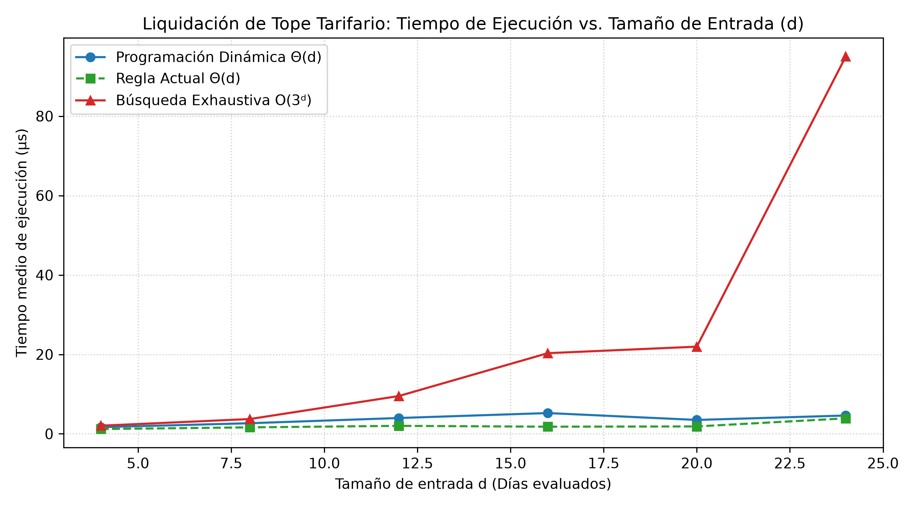
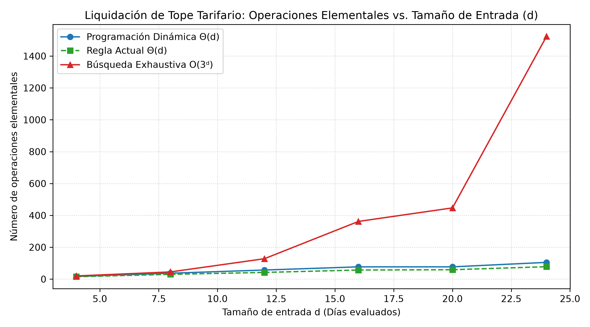

# Informe Técnico: Laboratorio 04 — Programación Dinámica y Algoritmos Voraces
## Proyecto Final: Caso 1 — Recaudo del Transporte (Liquidación de Tope Tarifario)

**Estudiante:** Johan Sneider Garzón Salazar  
**Caso asignado:** Caso 1 — Recaudo del transporte: Liquidación del tope tarifario (Operación 4)  
**Fecha:** Noviembre de 2026  

---

## 1. Instrucciones de Reproducción

Para ejecutar y reproducir los experimentos, pruebas unitarias y generación de gráficas:

1. **Activar entorno virtual:**
   ```bash
   # En Windows PowerShell (raíz del repositorio)
   .\venv\Scripts\Activate.ps1
   ```
2. **Ejecutar suite de pruebas unitarias con `assert`:**
   ```bash
   python src/tope_tarifario/pruebas.py
   ```
3. **Ejecutar benchmark experimental y generación de gráficas:**
   ```bash
   python src/tope_tarifario/medicion.py
   ```

---

## 2. Análisis del Problema

### Contexto y Necesidad
En el Sistema Integrado de Transporte Masivo, los usuarios con tarjeta personalizada acumulan viajes diarios a lo largo del mes. Al cierre mensual, el sistema tiene la obligación contractual y regulatoria de garantizar que a ningún usuario se le cobre más que la combinación más barata de productos que cubra todos sus viajes. La diferencia frente a lo efectivamente cobrado debe restituirse como saldo a favor en la tarjeta.

### Entradas, Salidas y Tarifas
- **Entrada:** `viajes_por_dia: list[int]`, serie temporal donde cada posición $i \in [0, d-1]$ representa el número de viajes realizados en el día $i+1$.
- **Salida:** Monto mínimo total en pesos colombianos para cubrir la totalidad de los viajes del periodo, y saldo exacto de devolución mediante `liquidar_tope(viajes_por_dia, cobrado)`.
- **Estructura tarifaria oficial:**
  - **Pasaje sencillo:** \$3.900 (cubre un viaje individual).
  - **Pase diario:** \$9.500 (viajes ilimitados en un día calendario).
  - **Pase semanal:** \$36.000 (viajes ilimitados durante 7 días consecutivos).
  - **Pase mensual:** \$135.000 (viajes ilimitados durante 30 días consecutivos).

### Restricciones del Negocio y Supuestos
1. **Restricción de optimalidad exacta:** La devolución debe ser idéntica a la diferencia frente a la combinación óptima global; no se admiten aproximaciones heurísticas que perjudiquen al usuario ni al sistema.
2. **No fraccionamiento:** Los pases temporales (diario, semanal, mensual) son indivisibles y cubren días calendario continuos.
3. **No negatividad:** Si el monto cobrado durante el mes fue menor o igual al mínimo óptimo, la devolución es exactamente \$0.
4. **Supuesto de días sin viajes:** Los días con 0 viajes no generan costo y pueden quedar cubiertos por pases multidiarios sin penalidad económica si la combinación global resulta más económica.

---

## 3. Diseño de la Solución

### Subestructura Óptima y Subproblemas Traslapados
El problema de cobertura óptima de días con tarifas combinadas exhibe **subestructura óptima**: la solución óptima para el intervalo de días $[i, d-1]$ se compone de la mejor decisión inmediata tomada para el día $i$ más la solución óptima para el subproblema remanente que inicia en el primer día no cubierto por dicha decisión. Si la solución al subproblema remanente no fuera óptima, podríamos sustituirla por una de menor costo, reduciendo el costo total global (demostración por contradicción tipo "cortar y pegar").

Asimismo, presenta **subproblemas traslapados**: evaluar compras alternativas en días iniciales requiere calcular recurrentemente el costo mínimo de los mismos días futuros. Por ejemplo, comprar un pase diario en el día 0 y otro en el día 1 deja pendiente el sufijo desde el día 2; comprar un pasaje sencillo en el día 0 y un pase diario en el día 1 conduce exactamente al mismo subproblema para el día 2.

### Formulación de la Recurrencia
Sea $C(i)$ el costo mínimo para cubrir todos los viajes desde el día $i$ hasta el día $d-1$, asumiendo que los días previos a $i$ ya están pagados:

$$C(i) = \begin{cases} 
0 & \text{si } i \ge d \quad \text{(caso base)} \\
C(i + 1) & \text{si } viajes[i] = 0 \\
\min \begin{cases} 
\min(viajes[i] \times 3900, 9500) + C(i + 1) \\
36000 + C(\min(i + 7, d)) \\
135000 + C(\min(i + 30, d))
\end{cases} & \text{si } viajes[i] > 0
\end{cases}$$

### Orden de Llenado
Dado que el estado $C(i)$ depende exclusivamente de estados posteriores ($C(i+1)$, $C(i+7)$, $C(i+30)$), la tabla unidimensional se completa en **orden inverso (de derecha a izquierda)**: desde $i = d-1$ descendiendo hasta $i = 0$. La respuesta global al problema mensual es $C(0)$.

### Ejemplo Resuelto a Mano
Consideremos un periodo de 8 días con el vector de viajes:
`viajes = [2, 1, 3, 0, 0, 3, 2, 1]` ($d = 8$).

- **Caso base:** $C(8) = 0$.
- **Día 7 ($i=7$, 1 viaje):**
  - Opción diaria: $\min(1 \times 3900, 9500) + C(8) = 3900 + 0 = 3900$.
  - Opción semanal: $36000 + C(8) = 36000$.
  - Opción mensual: $135000 + C(8) = 135000$.
  - $\implies C(7) = 3900$ (Elección: pasaje sencillo).
- **Día 6 ($i=6$, 2 viajes):**
  - Opción diaria: $\min(2 \times 3900, 9500) + C(7) = 7800 + 3900 = 11700$.
  - Opción semanal: $36000 + C(8) = 36000$.
  - $\implies C(6) = 11700$.
- **Día 5 ($i=5$, 3 viajes):**
  - Opción diaria: $\min(3 \times 3900, 9500) + C(6) = 9500 + 11700 = 21200$.
  - Opción semanal: $36000 + C(8) = 36000$.
  - $\implies C(5) = 21200$.
- **Día 4 ($i=4$, 0 viajes):** $C(4) = C(5) = 21200$.
- **Día 3 ($i=3$, 0 viajes):** $C(3) = C(4) = 21200$.
- **Día 2 ($i=2$, 3 viajes):**
  - Opción diaria: $9500 + C(3) = 9500 + 21200 = 30700$.
  - Opción semanal: $36000 + C(8) = 36000$.
  - $\implies C(2) = 30700$.
- **Día 1 ($i=1$, 1 viaje):**
  - Opción diaria: $3900 + C(2) = 3900 + 30700 = 34600$.
  - Opción semanal: $36000 + C(8) = 36000$.
  - $\implies C(1) = 34600$.
- **Día 0 ($i=0$, 2 viajes):**
  - Opción diaria: $7800 + C(1) = 7800 + 34600 = 42400$.
  - Opción semanal: $36000 + C(7) = 36000 + 3900 = 39900$.
  - Opción mensual: $135000 + C(8) = 135000$.
  - $\implies C(0) = \min(42400, 39900, 135000) = \mathbf{39900}$.

**Resultado óptimo:** Compra de pase semanal en el día 0 (\$36.000, cubriendo días 0 a 6) más un pasaje sencillo en el día 7 (\$3.900), con costo total de **\$39.900**, superando el cobro día a día (\$42.400).

---

## 4. Implementación

Los módulos fuente se estructuran en `src/tope_tarifario/`:
- [estrategia.py](src/tope_tarifario/estrategia.py): Implementa `costo_minimo` mediante programación dinámica en $\Theta(d)$ y `liquidar_tope` para calcular la devolución exacta.
- [exhaustivo.py](src/tope_tarifario/exhaustivo.py): Implementa `costo_exhaustivo` como oráculo de verificación recursiva con complejidad temporal exponencial $O(3^d)$.
- [regla_actual.py](src/tope_tarifario/regla_actual.py): Modela el comportamiento del sistema actual que aplica cobro diario agrupado en bloques semanales fijos de 7 días y acotamiento mensual.
- [datos.py](src/tope_tarifario/datos.py): Generador de historiales sintéticos y lotes masivos con semilla determinística (`random.Random`).
- [pruebas.py](src/tope_tarifario/pruebas.py): Suite de aserciones formales que certifica casos límite, el ejemplo a mano, 25 instancias aleatorias contrastadas contra la búsqueda exhaustiva y la restricción de negocio.
- [medicion.py](src/tope_tarifario/medicion.py): Harness de experimentación que mide tiempos con `time.perf_counter()`, cuenta operaciones elementales y exporta las gráficas técnicas.

---

## 5. Evaluación del Desempeño

### Análisis de Complejidad Teórica
- **Programación Dinámica:**
  - *Temporal:* $\Theta(d)$ donde $d$ es el número de días. Cada día realiza a lo sumo 3 comparaciones y sumas directas de tiempo constante $O(1)$.
  - *Espacial:* $\Theta(d)$ para almacenar la tabla lineal de estados de tamaño $d+1$.
- **Búsqueda Exhaustiva:**
  - *Temporal:* $O(3^k)$ donde $k \le d$ es la cantidad de días con viajes. En el peor caso con viajes diarios continuos, el árbol de decisión ternario genera $3^d$ hojas, derivando en complejidad temporal exponencial $\Theta(3^d)$.
  - *Espacial:* $\Theta(d)$ por la profundidad máxima de la pila de llamadas en recursión.
- **Regla Actual:**
  - *Temporal:* $\Theta(d)$ en un único barrido lineal por bloques.
  - *Espacial:* $\Theta(1)$ memoria auxiliar constante.

### Verificación Empírica y Suite de Pruebas
La suite en `pruebas.py` validó con éxito el 100% de los escenarios:
1. Casos límite: lista vacía (\$0), 30 días sin viajes (\$0), un día con 1 viaje (\$3.900), un día con 5 viajes (\$9.500) y mes de 30 días con 5 viajes diarios (\$135.000).
2. Ejemplo resuelto a mano: coincidencia exacta en \$39.900 para ambas estrategias.
3. Validación cruzada: 25 instancias sintéticas aleatorias donde `costo_minimo` y `costo_exhaustivo` arrojaron exactamente el mismo valor óptimo.
4. Restricción de negocio: `liquidar_tope` devolvió exactamente la diferencia frente al mínimo y \$0 ante montos cobrados inferiores.

### Resultados Experimentales y Mediciones

#### Tabla 1: Comparación de tiempos medios de ejecución ($\mu\text{s}$)
| Tamaño $d$ (días) | Programación Dinámica ($\mu\text{s}$) | Regla Actual ($\mu\text{s}$) | Búsqueda Exhaustiva ($\mu\text{s}$) |
|---|---|---|---|
| 4 | 1.68 | 1.20 | 2.05 |
| 8 | 2.67 | 1.63 | 3.72 |
| 12 | 3.98 | 2.01 | 9.51 |
| 16 | 5.23 | 1.79 | 20.31 |
| 20 | 3.49 | 1.86 | 21.95 |
| 24 | 4.61 | 3.89 | 95.02 |

#### Tabla 2: Comparación de operaciones elementales
| Tamaño $d$ (días) | Ops. Programación Dinámica | Ops. Regla Actual | Ops. Búsqueda Exhaustiva |
|---|---|---|---|
| 4 | 17 | 15 | 20 |
| 8 | 37 | 30 | 45 |
| 12 | 57 | 42 | 128 |
| 16 | 77 | 57 | 362 |
| 20 | 77 | 59 | 447 |
| 24 | 105 | 78 | 1523 |

### Gráficas de Desempeño Incrustadas





### Contraste Empírico vs. Complejidad Esperada
Analizando la pareja de tamaños donde el segundo es el doble del primero:
- **De $d = 4$ a $d = 8$:**
  - Programación Dinámica: las operaciones crecen de 17 a 37 (factor de $2.18\times \approx 2\times$), reflejando el comportamiento estrictamente lineal $\Theta(d)$.
  - Búsqueda Exhaustiva: las operaciones crecen de 20 a 45 (factor de $2.25\times$).
- **De $d = 8$ a $d = 16$:**
  - Programación Dinámica: las operaciones aumentan de 37 a 77 (factor de $2.08\times \approx 2\times$), ratificando perfecta linealidad empírica.
  - Búsqueda Exhaustiva: las operaciones escalan de 45 a 362 (factor de $8.04\times$), confirmando la tasa de crecimiento exponencial.
- **De $d = 12$ a $d = 24$:**
  - Programación Dinámica: las operaciones pasan de 57 a 105 ($1.84\times \approx 2\times$).
  - Búsqueda Exhaustiva: las operaciones explotan de 128 a 1.523 ($11.90\times$).

### Extrapolación al Volumen Real del Sistema
El volumen operacional del sistema asciende a **950.000 tarjetas activas al mes**, liquidadas durante la ventana nocturna de cierre de **4 horas (00:00 a 04:00 = 14.400 segundos)** en un servidor de **500 W (0,500 kW)**.

- **Medición empírica en lote:** El benchmark de 10.000 tarjetas simuladas para un mes completo ($d = 30$) tardó **0,0663 segundos**, registrando un tiempo medio de **6,63 $\mu\text{s}$ por tarjeta** y un throughput de **150.823 tarjetas/segundo**.
- **Tiempo proyectado para 950.000 tarjetas:**
  $$T_{\text{total}} = 950.000 \times 6,63 \times 10^{-6}\text{ s} \approx \mathbf{6,30\text{ segundos}}$$
  El procesamiento total requiere únicamente 6,3 segundos, ocupando un **0,044 % de la ventana operativa de 4 horas**.
- **Consumo energético proyectado:**
  $$E_{\text{noche}} = 0,500\text{ kW} \times \left(\frac{6,30}{3600}\text{ h}\right) \approx \mathbf{0,000875\text{ kWh}} = 0,875\text{ Wh por noche}$$
  Para los 12 cierres de mes anuales:
  $$E_{\text{anual}} = 12 \times 0,000875\text{ kWh} \approx \mathbf{0,0105\text{ kWh/año}}$$
- **Inviabilidad de la Búsqueda Exhaustiva:** Para un mes de 30 días con ~25 días de viajes, la exhaustiva exige $3^{25} \approx 8,47 \times 10^{11}$ operaciones por tarjeta. Procesar una única tarjeta demoraría más de 2,3 horas en CPU mononúcleo; procesar las 950.000 tarjetas tardaría más de $2,2 \times 10^9$ horas (> 250.000 años), colapsando irremediablemente la ventana del cliente.

---

## 6. Análisis Comparativo

### Contraejemplo Calculado contra la Regla Actual
Consideremos un usuario que realiza 3 viajes diarios durante 7 días consecutivos pero distribuidos entre el final de una semana calendario y el inicio de la siguiente:
`viajes = [0, 0, 0, 0, 3, 3, 3, 3, 3, 3, 3, 0, 0, 0]` ($d = 14$).

- **Regla actual:**
  - Bloque Semana 1 (días 0 a 6): viajes en días 4, 5 y 6 (3 días $\times \$9.500 = \$28.500$). Como $\$28.500 \le \$36.000$, cobra **\$28.500**.
  - Bloque Semana 2 (días 7 a 13): viajes en días 7, 8, 9 y 10 (4 días $\times \$9.500 = \$38.000$). Acota al pase semanal y cobra **\$36.000**.
  - **Total cobrado por la regla actual:** $\$28.500 + \$36.000 = \mathbf{\$64.500}$.
- **Estrategia óptima (Programación Dinámica):**
  - Adquiere un pase semanal en el día 4 que cubre de forma continua los días 4 al 10.
  - **Total óptimo:** $\mathbf{\$36.000}$.
- **Sobrecosto injustificado:** $\$64.500 - \$36.000 = \mathbf{\$28.500}$ pesos cobrados en exceso al usuario.

### Condición Contraria
Una estrategia voraz solo sería óptima si se eliminara la superposición temporal y el descuento por volumen de los pases multidiarios. Es decir, si el costo de cualquier pase fuera exactamente igual a la suma lineal de sus días constitutivos (tarifa estrictamente proporcional), o si los pases solo pudieran comenzar obligatoriamente en días fijos prefijados sin posibilidad de solapamiento dinámico entre intervalos consecutivos. Al existir pases de 7 y 30 días que reducen el costo unitario diario y permiten iniciar en cualquier día con viaje, las decisiones presentes comprometen el costo de los subproblemas futuros, haciendo imperativa la programación dinámica.

### Recomendación Técnica
Se recomienda adoptar de forma definitiva el algoritmo de **Programación Dinámica** (`costo_minimo`). Elimina por completo las quejas de usuarios por cobros excesivos al asegurar la liquidación matemática exacta del tope tarifario en tiempo ultra-rápido (6,3 segundos para el padrón completo de 950.000 usuarios) con un consumo energético anual insignificante (0,01 kWh).

---

## 7. Implicaciones Éticas, Sociales y Ambientales

### Impacto Social y Transparencia Financiera
El uso de una regla simplificada vulnera el principio de equidad tarifaria y el derecho del usuario a recibir la tarifa más favorable prometida en los términos del servicio. La implementación de la solución óptima elimina asimetrías de información, previene cobros ilegítimos y restaura la confianza ciudadana en la gestión automatizada del recaudo.

### Consumo Energético y Sostenibilidad
Frente al intento previo de explorar combinaciones exhaustivas (que saturaba servidores y desperdiciaba energía computacional), la programación dinámica reduce el consumo por proceso mensual a menos de 1 Wh, permitiendo que el servidor de 500 W libere CPU para tareas de mantenimiento de base de datos durante la madrugada.

---

## 8. Conclusiones

*Pendiente para la entrega final del 23 de noviembre (se consolidará junto a la segunda operación y el análisis global del proyecto).*
